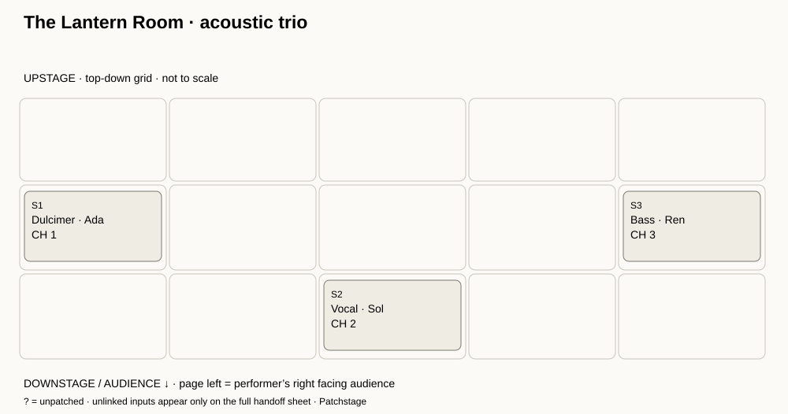

# Patchstage

**A clear stage plot and input patch, in one local workspace.**

[Open Patchstage](https://patchstage.vercel.app)

Plan a small act without choosing from an instrument catalog. Place custom-labeled stations, link each audio source to its station, and export a readable handoff for the venue.



*Generated stage SVG from the included example, not an editor screenshot.*

## What you can do

- Place up to 12 custom stations on a keyboard-operable 5 × 3 stage grid.
- Describe up to 32 input sources, with channel numbers 1–64, mic / DI, stand, equipment provider and notes.
- Review duplicate channel numbers, unpatched or unlinked inputs, unspecified devices/providers, shared grid cells and stations without inputs.
- Edit labels and assignments with 25-step undo / redo.
- Save a resumable project, a full HTML handoff, a stage SVG, and a structured audit receipt.
- Keep entered data in your browser’s memory. No accounts, analytics, application requests, or cloud storage.

## Run locally

Node.js 22 or 24 and npm:

```sh
npm ci --ignore-scripts --no-audit --no-fund
npm test
npm run example
npm run build
npm run dev
```

Open **http://127.0.0.1:4197**. The dev server serves only the built assets on the loopback interface. Rebuild after source changes.

Runtime application code has no third-party dependencies. jsdom is a development dependency for simulated DOM checks.

## Make a handoff

1. Load the example or start a blank plot. Enter a show title and notes; select **Save show**.
2. Add a station with any label: a person, instrument or rig. Set its column and depth. To move an existing station with the placement buttons, select **Edit / select** first.
3. Add each source separately. A stereo source needs two explicitly labeled inputs; stereo links are not inferred. Blank channel and station fields remain visibly unresolved.
4. Enter the mic / DI, stand and who supplies the mic / DI. “Act” and “Venue” describe your request, not confirmed availability.
5. Read **Before you send** and resolve or explain its notes. Duplicate channels are retained so you can inspect the conflict.
6. Save your **project JSON** before closing. Open the **handoff HTML** to print or save as PDF using your browser. Send the sheet to the venue for confirmation.

A station with linked inputs cannot be deleted until its inputs are reassigned or unlinked. Unsaved form drafts block other changes and downloads; save or clear the draft first. Opening a project replaces the saved plot and can be undone.

## Files

| Export | Includes |
| --- | --- |
| Project JSON | All editable fields, stable station/input IDs and grid positions |
| Handoff HTML | Plot, **all** input rows, all review notes and show notes; standalone printable document |
| Stage SVG | Station labels, grid positions and linked channel numbers; **not** the full input list |
| Audit receipt | Entire project, derived channel-ordered patch with station labels and diagnostics |

Unpatched sources sort last. Duplicate channel rows keep their original relative order. A stage SVG marks unpatched linked inputs with `?`; unlinked inputs appear in the full handoff and receipt. Shared-cell stations are stacked to preserve their labels, so the drawing is an approximate layout.

Explore the actual [project](examples/trio-project.json), [handoff](examples/trio-handoff.html), [stage SVG](examples/trio-stage.svg), and [receipt](examples/trio-receipt.json). The example is invented and equipment descriptions are illustrative.

## Privacy and limits

There is **no autosave**. Closing or refreshing loses edits unless you saved project JSON. The host receives ordinary asset requests; entered project content is not uploaded by the application. Downloaded files can contain sensitive show notes: share them deliberately.

The grid is top-down with the audience at the bottom. Page left is the performer’s right when facing the audience. It is **not to scale** and shared cells do not indicate physical clearance.

This is a planning draft, not a technical rider standard, engineering tool, or equipment specification. It does not verify availability, microphone suitability, signal compatibility, electrical or structural safety. There are no monitor mixes, dimensions, power distribution, stagebox/console mapping, phantom-power checks, automatic stereo linking or console exports. Confirm everything with the venue and crew.

Limits: 80-character title, 1,000-character show notes, 48-character station labels, 64-character source/device labels, 40-character stands, 160-character input notes (JavaScript UTF-16 units). JSON imports accept this version’s exact fields only, up to 60,000 characters / 240,000 UTF-8 bytes. Malformed UTF-8, unsupported fields and dangling links reject the entire import; the current plot stays intact.

## Verification

`npm test` checks model bounds, immutable edits, 25-step history, 60 generated patch partitions, complete exports, duplicate retention, maximum station/input capacity, shared-cell layout bounds, Unicode and markup escaping, malformed file handling, and actual app event handlers/download Blob contents in jsdom.

CI runs Node 22/24 on Windows and Linux. Tests use a **simulated DOM**. Native browser interaction, responsive visual rendering, assistive technology, native download destinations, physical print output and an actual editor screenshot have not been verified. The illustration above is a generated export.

## Deploy manually on Vercel

Import this repository into your Vercel account. Use framework **Other**, Node **24.x**, build command `npm run build`, output directory `dist`, and an empty install command. The static build uses only Node built-ins. No environment variables or paid services are required. The included `vercel.json` sets these options and restrictive security headers.

## Project structure

`src/model.mjs` validates and audits projects; `edit.mjs` applies reversible edits; `export.mjs` generates escaped files; `app.mjs` handles the editor; `handoff.mjs` guards file reads and object URLs. See [the file-format notes](docs/file-format.md).

MIT licensed.
